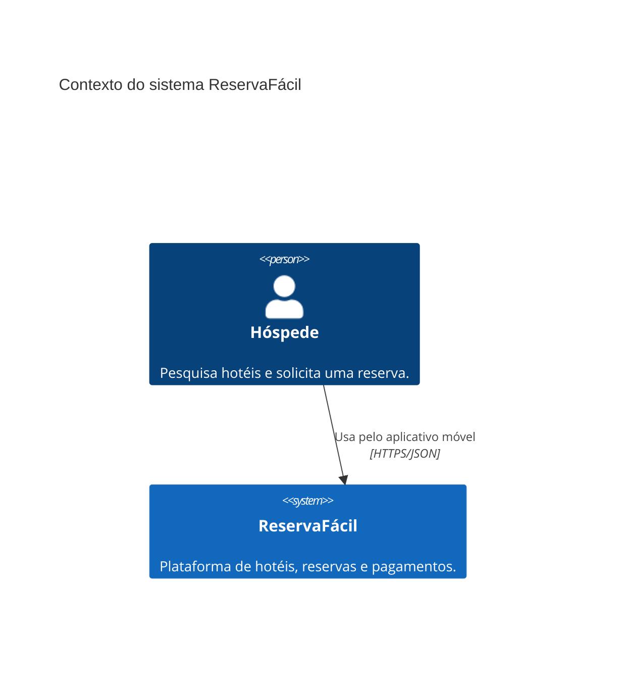
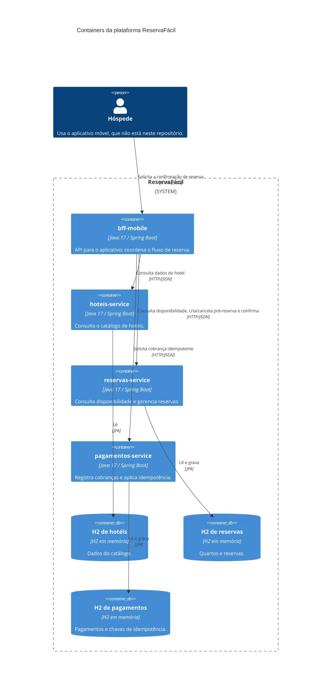
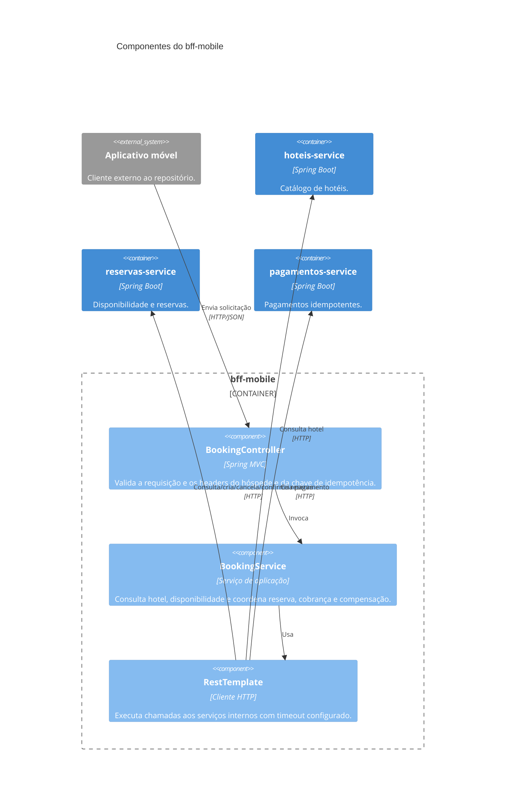

# ReservaFácil

Aplicação de demonstração para consulta de hotéis e confirmação de reservas com pagamento. O repositório implementa quatro serviços Spring Boot independentes, que se comunicam por HTTP: um BFF para o aplicativo móvel e três serviços de domínio.

> Esta documentação descreve o código presente no repositório. O aplicativo móvel, a interface do painel dos hotéis, um API Gateway e uma integração com uma operadora de pagamentos não fazem parte desta implementação.

## Arquitetura

### C4 — Contexto

O hóspede interage com a plataforma por meio do aplicativo móvel. O aplicativo é externo a este repositório; o BFF é a entrada HTTP implementada para o fluxo de reserva.



### C4 — Containers

Cada serviço é um módulo Maven executável e tem seu próprio banco H2 em memória. O BFF coordena as chamadas síncronas entre os serviços; não há mensageria nesta implementação.



### C4 — Componentes do BFF Mobile



## Serviços e APIs

| Módulo | Porta padrão | Responsabilidade | Endpoints principais |
|---|---:|---|---|
| `hoteis-service` | `8081` | Catálogo de hotéis, fotos e comodidades | `GET /v1/hoteis`, `GET /v1/hoteis/{id}` |
| `reservas-service` | `8082` | Disponibilidade e ciclo de vida das reservas | `GET /v1/quartos/disponibilidade`, `POST /v1/reservas`, `GET /v1/reservas/{id}`, `GET /v1/reservas/idempotencia/{chave}`, `POST /v1/reservas/{id}/confirmacao`, `DELETE /v1/reservas/{id}` |
| `pagamentos-service` | `8083` | Registro e consulta de cobranças | `POST /v1/pagamentos`, `GET /v1/pagamentos/{id}` |
| `bff-mobile` | `8080` | API do aplicativo e orquestração do fluxo de reserva | `POST /app/v1/confirmacoes-reserva` |

Todos os serviços publicam OpenAPI em `/v3/api-docs` e Swagger UI em `/swagger-ui.html`. O contrato OpenAPI de pagamentos está em [`pagamentos-service/src/main/resources/static/openapi.yaml`](pagamentos-service/src/main/resources/static/openapi.yaml) e é exposto em `/openapi.yaml`.

## Fluxo de confirmação

1. O BFF recebe hotel, quarto, datas, método de pagamento, `X-User-Id` e um UUID em `Idempotency-Key`.
2. Consulta os dados do hotel. Se a chamada falhar por timeout/conexão, usa dados padrão para a resposta.
3. Consulta a disponibilidade e cria uma pré-reserva, que bloqueia o quarto por 15 minutos.
4. Solicita o pagamento usando a mesma chave de idempotência. Uma repetição da chave no serviço de pagamentos retorna o resultado previamente registrado, sem criar uma nova cobrança.
5. Se o pagamento for recusado, o BFF tenta cancelar a pré-reserva e responde com erro de pagamento.
6. Se aprovado, confirma a reserva e retorna os dados do hotel, da reserva e do pagamento.

O header `X-User-Id` representa a identidade do hóspede para este estudo; não é autenticação real. O serviço de reservas verifica que operações sobre uma reserva pertencem ao titular. O campo `simularRecusa` permite exercitar o caminho de pagamento recusado.

## Requisitos

- Java 17
- Maven 3.8+

## Compilar e testar

Na raiz do repositório:

```bash
mvn clean verify
```

O build executa os testes dos módulos, incluindo testes Pact consumidor/provedor entre `bff-mobile` e `pagamentos-service`.

## Executar localmente

Inicie cada serviço em um terminal separado, a partir da raiz:

```bash
mvn -pl hoteis-service spring-boot:run
mvn -pl reservas-service spring-boot:run
mvn -pl pagamentos-service spring-boot:run
mvn -pl bff-mobile spring-boot:run
```

Os três serviços de domínio têm bancos H2 independentes e em memória; os dados não persistem após o encerramento do processo. Todos os serviços permitem configurar a porta com `SERVER_PORT`; os serviços de domínio também aceitam `DATABASE_URL`. O BFF usa estas configurações:

| Variável | Padrão |
|---|---|
| `HOTEIS_SERVICE_URL` | `http://localhost:8081` |
| `RESERVAS_SERVICE_URL` | `http://localhost:8082` |
| `PAGAMENTOS_SERVICE_URL` | `http://localhost:8083` |
| `INTERNAL_TIMEOUT` | `400ms` |

## Exemplo de requisição

Com os quatro serviços em execução:

```bash
curl -i http://localhost:8080/app/v1/confirmacoes-reserva \
  -H 'Content-Type: application/json' \
  -H 'X-User-Id: hospede-123' \
  -H 'Idempotency-Key: 123e4567-e89b-12d3-a456-426614174000' \
  -d '{"hotelId":1,"quartoId":101,"entrada":"2027-01-10","saida":"2027-01-12","metodo":"CARTAO"}'
```

Para simular recusa, inclua `"simularRecusa":true` no JSON. Ao repetir uma tentativa, reutilize a mesma `Idempotency-Key`; para uma nova tentativa, gere um novo UUID.
